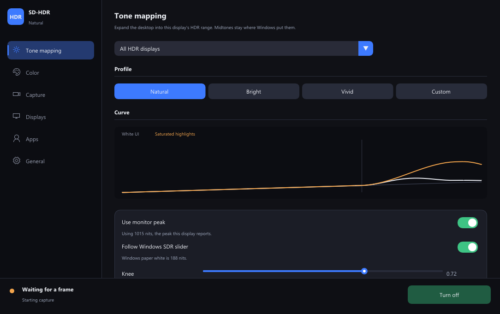

# SD-HDR

SD-HDR expands the Windows desktop into your monitor's HDR range. It captures the screen, runs a Direct3D 11 shader, and shows the result in a click-through overlay. Mouse and keyboard still reach the real windows. It does not inject into other programs, and it does not use an NVIDIA, AMD, or Intel SDK.

One 64-bit build runs on other 64-bit Windows 10 and 11 PCs. Windows HDR must be on for the display you want to expand. The Windows **SDR content brightness** slider is the paper-white reference.



## Download

Grab **SDHDR.exe** and the **shaders** folder from the [latest release](https://github.com/wrenchie-v/SD-HDR/releases/latest) and keep them side by side. If the program fails to start, install the [Microsoft Visual C++ Redistributable](https://learn.microsoft.com/en-us/cpp/windows/latest-supported-vc-redist).

Close the window and it keeps running in the tray. Exit from the tray icon. **Ctrl+Alt+H** turns the effect off.

## What you can change

- **Tone mapping.** Natural, Bright, and Vivid profiles, plus Custom. A live curve shows white UI against saturated highlights. Paper white stays near the Windows slider. Highlights roll up above that instead of being slammed into the panel peak.
- **Color.** Saturation, gamut expansion from the display primaries, and protection for white text. Decode can be sRGB or gamma 2.2. Output is scRGB, with an optional HDR10 PQ path.
- **Capture.** Auto, Windows Graphics Capture, or Desktop Duplication, plus a GPU time budget.
- **Displays.** Live peak, minimum, full-frame peak, and SDR white from the monitor.
- **Apps.** Fullscreen content that is already HDR is left alone. Pin a process to always on or always off.
- **General.** Start with Windows, start in the tray, and the global hotkey.

## Build

You need Visual Studio 2022 (or the Build Tools) with the MSVC toolset and the Windows 11 SDK, plus CMake 3.24 or newer. Dear ImGui 1.91.8 is included under `third_party/imgui`.

```powershell
cmake -S . -B build -G "Visual Studio 17 2022" -A x64
cmake --build build --config Release
.\build\Release\SDHDR.exe
```

`build.ps1` does the same thing when CMake is on your PATH or under `tools\`. Shaders are copied next to the executable.

To stage a folder you can zip or hand to Inno Setup:

```powershell
cmake --install build --config Release --prefix dist
```

`installer/sdhdr.iss` is an Inno Setup 6 script for that `dist` folder.

## Command line

| Flag | What it does |
| --- | --- |
| `--dump-caps` | Prints each monitor's HDR metadata and the Windows SDR white level |
| `--self-test` | Checks the color math and runs the tone curve on every hardware GPU |
| `--minimized` | Starts in the tray |
| `--ui-smoke <prefix>` | Saves PNG captures of the settings window and exits |
| `--click-test` | Checks that the overlay does not take mouse clicks |

## How it works

1. Windows Graphics Capture, or Desktop Duplication, grabs the monitor. FP16 scRGB is preferred. 8-bit frames are decoded as sRGB or gamma 2.2.
2. Pixels already above the Windows SDR white level are treated as native HDR and passed through.
3. Midtones stay where Windows put them. White, low-saturation UI is held near paper white.
4. Saturated highlights roll up above paper white on a smooth shoulder, using only part of the headroom to the monitor peak, so 8-bit gradients do not break into bands.
5. Chroma can expand toward the primaries reported by the display. If those primaries are missing, the target is DCI-P3.
6. The result is presented as scRGB (`R16G16B16A16_FLOAT`, `DXGI_COLOR_SPACE_RGB_FULL_G10_NONE_P709`) on a waitable flip-model swapchain. HDR10 PQ is optional.

The overlay is topmost, layered, and click-through, and it is excluded from capture, so it cannot recapture itself.

## Limits

- Exclusive fullscreen and protected video are not captured.
- A fullscreen app that is already HDR is bypassed so the image is not expanded twice.
- The taskbar and Start menu appear from the capture, about a frame later. Clicks still hit the real taskbar.
- On Windows 10, Graphics Capture can draw a yellow border. Auto mode uses Desktop Duplication there, because that border can only be removed on Windows 11.
- The effect adds about one frame of latency. The status bar shows GPU time, frames per second, and capture age.

## License

[MIT](LICENSE). The bundled Dear ImGui files in `third_party/imgui` remain under their own MIT license.
